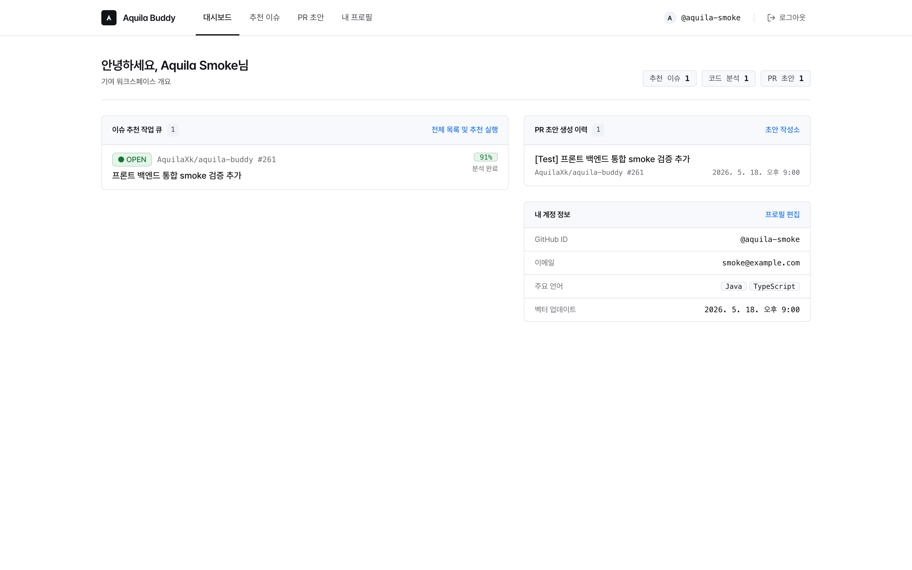
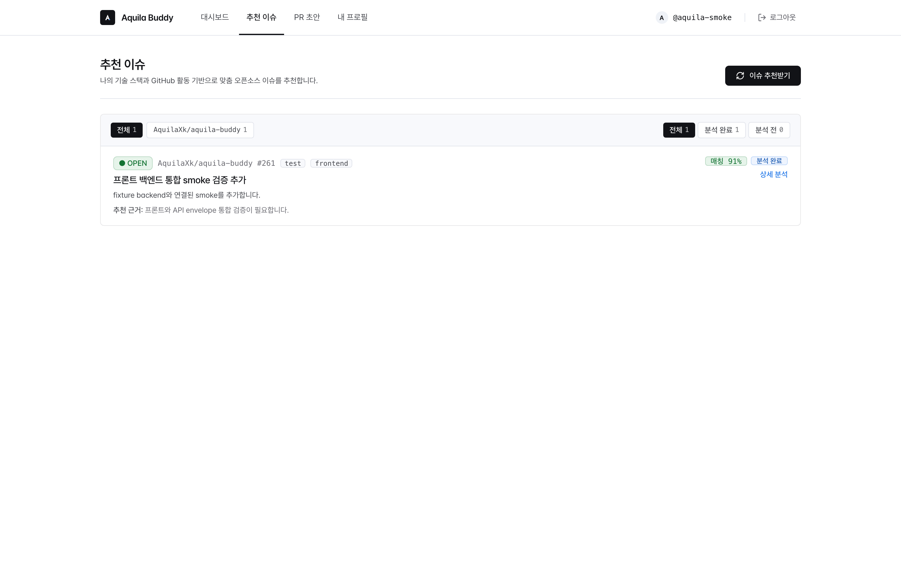
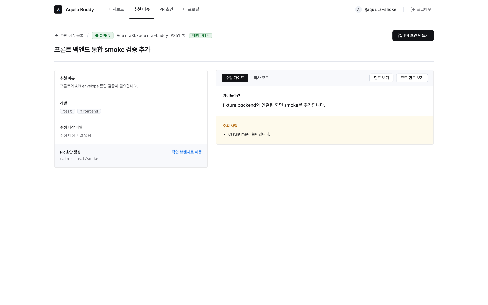
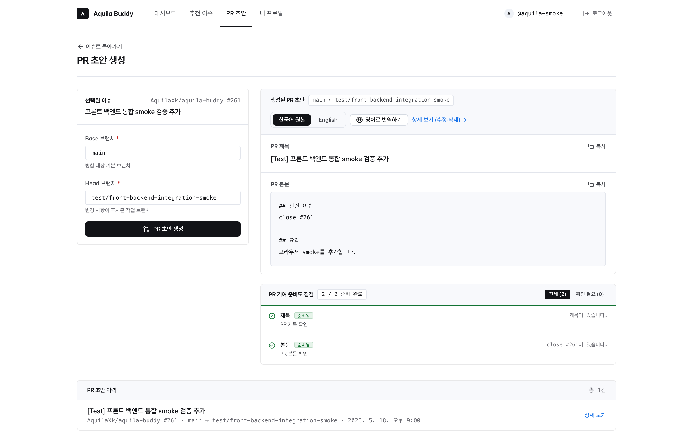
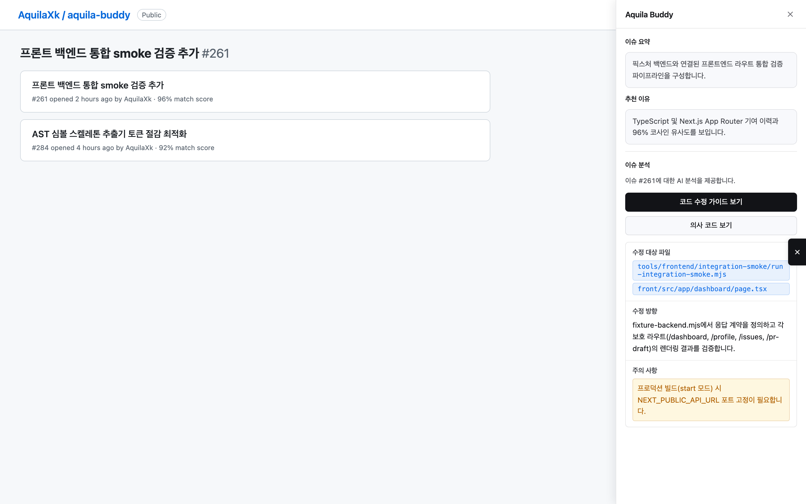
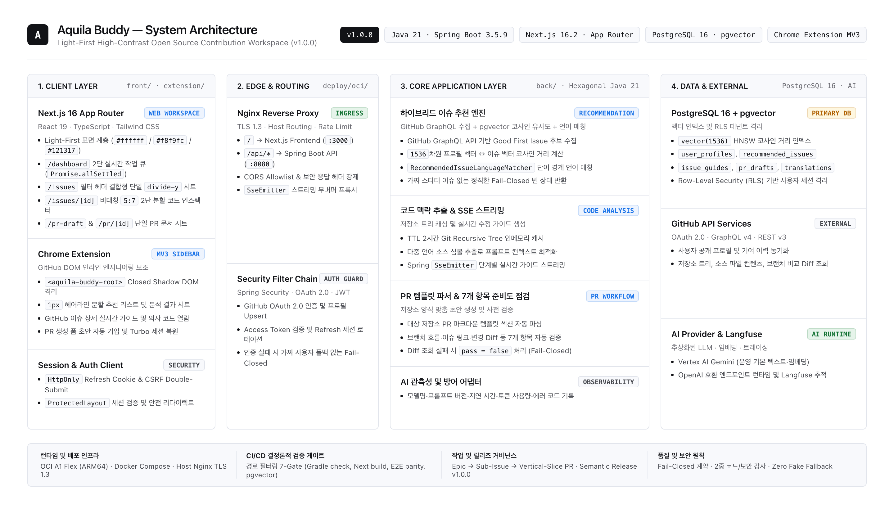

# Aquila Buddy

> GitHub 오픈소스 이슈 추천, 코드 맥락 분석, 단계별 기여 가이드, PR 초안 작성을 단일 워크스페이스로 지원하는 기여 플랫폼입니다.

<p align="center">
  <a href="https://buddy.aquilaxk.site">
    
  </a>
</p>

<p align="center">
  <a href="https://buddy.aquilaxk.site">
    
  </a>
  &nbsp;
  <a href="https://github.com/AquilaXk/aquila-buddy">
    
  </a>
</p>

<p align="center">
  
  
  
  
  
  
  
</p>

---

## 목차

- [프로젝트 개요](#프로젝트-개요)
- [주요 기능](#주요-기능)
- [시스템 아키텍처](#시스템-아키텍처)
- [주요 프로세스 / AI 설계](#주요-프로세스--ai-설계)
- [기술 스택](#기술-스택)
- [시작하기](#시작하기)
- [환경 변수](#환경-변수)
- [데이터와 pgvector](#데이터와-pgvector)
- [API 명세](#api-명세)
- [테스트와 Smoke](#테스트와-smoke)
- [CI/CD](#cicd)
- [운영과 배포](#운영과-배포)
- [트러블 슈팅](#트러블-슈팅)
- [현재 상태와 개선 방향](#현재-상태와-개선-방향)
- [License](#license)
- [관련 링크](#관련-링크)

---

## 프로젝트 개요


### 서비스 화면

Aquila Buddy는 GitHub 프로필 분석에서 추천 이슈 탐색, 이슈별 코드 맥락 분석, PR 초안 작성 및 기여 준비도 점검까지 이어지는 엔지니어링 워크스페이스를 제공합니다. 웹(`front/`)과 Chrome 확장 프로그램(`extension/`) 모두 고대비 라이트 표면 계층(`#ffffff` / `#f8f9fc`), `#121317` 차콜 타이포그래피 및 주요 액션, `1px` 구조적 헤어라인 보더, `tabular-nums` 수치 정렬 기반의 **Light-First High-Contrast Workspace**로 구현되어 있습니다.

<table>
  <tr>
    <td width="50%">
      
      <br />
      <strong>대시보드 (`/dashboard`)</strong>
      <br />
      프로필·추천 이슈 이력·PR 초안 이력을 병렬 조회(`Promise.allSettled`)하여 좌측 7컬럼 `이슈 추천 작업 큐`와 우측 5컬럼 `PR 초안 생성 이력` 및 평면 `divide-y` `내 계정 정보` 정의 리스트를 표시합니다.
    </td>
    <td width="50%">
      
      <br />
      <strong>추천 이슈 (`/issues`)</strong>
      <br />
      GitHub GraphQL 이슈 수집과 pgvector 코사인 유사도·언어 일치도를 결합한 추천 결과를 필터 헤더(`.sheet-header`)가 통합된 단일 `divide-y` 고밀도 리스트로 탐색합니다.
    </td>
  </tr>
  <tr>
    <td width="50%">
      
      <br />
      <strong>이슈 분석 (`/issues/[id]`)</strong>
      <br />
      상단 헤더 우측에 `PR 초안 만들기` 주 액션을 고정하고, 좌측 5컬럼(추천 이유·라벨·수정 대상 파일 경로)과 우측 7컬럼(`수정 가이드` / `의사 코드` 탭 인스펙터)의 `5:7` 2단 분할 뷰를 제공합니다.
    </td>
    <td width="50%">
      
      <br />
      <strong>PR 초안 (`/pr-draft`, `/pr/[id]`)</strong>
      <br />
      좌측 4컬럼 브랜치 설정 폼과 우측 8컬럼 단일 `divide-y` PR 문서 시트(제목·본문·Diff), 평면 헤어라인 테이블 기반의 PR 기여 준비도 점검(7개 항목 자동 검증) 및 한/영 번역을 지원합니다.
    </td>
  </tr>
  <tr>
    <td colspan="2">
      
      <br />
      <strong>Chrome 확장 프로그램 (`extension/`)</strong>
      <br />
      `<aquila-buddy-root>` Closed Shadow DOM으로 스타일을 격리하고, `1px` 헤어라인 분할 추천 리스트와 실시간 코드 분석 결과 시트, GitHub PR 생성 폼 초안 자동 기입을 지원합니다.
    </td>
  </tr>
</table>

### 배경

오픈소스 기여 과정에서 이슈를 선택한 뒤에도 저장소 구조, 수정 범위, PR 본문 양식까지 직접 파악해야 합니다. Aquila Buddy는 이 과정을 단일 워크스페이스 흐름으로 묶어 이슈 추천, 코드 맥락 분석, PR 초안 작성과 사전 점검을 지원합니다.

| 문제 | 설명 |
|------|------|
| 이슈 탐색 비용 | Good First Issue 후보가 많아도 사용자 기술 스택과 맞는지 판단하기 어렵습니다. |
| 코드 맥락 부족 | issue metadata만으로는 관련 파일, 수정 방향, side effect를 파악하기 어렵습니다. |
| PR 작성 부담 | contribution guide, issue context, diff context를 반영한 PR 문안을 매번 새로 작성해야 합니다. |
| 운영 검증 난이도 | AI provider, GitHub API, pgvector, extension이 함께 동작하는지 분리해서 확인하기 어렵습니다. |

### 목표

GitHub OAuth로 로그인한 사용자의 profile vector와 GitHub issue vector를 기반으로 추천 순위를 계산하고, 선택한 이슈에 대해 코드 맥락 기반 가이드와 PR 초안 및 기여 준비도 점검 결과를 제공합니다. 최종 PR 생성과 제출은 사용자가 검토 후 직접 수행합니다.

| 구분 | AS-IS | TO-BE |
|------|-------|-------|
| 이슈 선택 | label과 제목을 수동으로 비교 | profile/issue embedding 기반 추천 |
| 분석 방식 | issue 본문 중심 확인 | repository code context와 관련 파일 기반 `5:7` 분할 인스펙터 |
| PR 준비 | 빈 editor에서 직접 작성 | issue, diff, template, guide를 반영한 단일 문서 시트 및 7개 항목 준비도 점검 |
| 운영 확인 | 로컬 fixture 중심 확인 | provider, pgvector, Langfuse, extension smoke로 분리 검증 |

### 핵심 가치

- **추천 가능성**: GitHub profile, 관심 topic, language, issue embedding을 추천 입력으로 사용합니다.
- **코드 맥락 우선**: repository tree와 code search 결과를 바탕으로 수정 후보 파일과 side effect를 정리합니다.
- **제출 전 점검**: PR 초안, 한/영 번역, 7개 항목 기여 준비도 점검 결과를 제공해 제출 전 누락을 줄입니다.
- **운영 검증 및 거버넌스**: secret이 필요한 live smoke와 fixture 기반 CI를 분리하고, `Epic → Sub-Issue → Vertical-Slice PR` 작업 구조로 변경 이력을 관리합니다.

---

## 주요 기능

| 기능 | 설명 |
|------|------|
| GitHub OAuth & 세션 관리 | GitHub 계정으로 로그인하고 사용자 profile, nickname, email, avatar 및 HttpOnly Refresh Token 세션을 동기화합니다. |
| Profile Vector 생성 및 갱신 | 관심 topic, 주 언어, GitHub 활동 맥락을 기반으로 1536차원 사용자 profile embedding을 생성하고 갱신합니다. |
| GitHub GraphQL & REST 이슈 수집 | GitHub GraphQL API와 REST search를 결합해 Good First Issue 및 추천 후보를 수집합니다. |
| 하이브리드 pgvector 추천 | PostgreSQL pgvector 환경에서 프로필/이슈 코사인 유사도와 주 사용 언어 일치도를 결합해 추천 순위를 산출합니다. |
| Git Tree 캐시 & 코드 심볼 추출 | TTL 2시간 Git 재귀 트리 인메모리 캐시와 언어별 심볼 추출로 프롬프트에 필요한 코드 시그니처를 선별합니다. |
| Spring Boot SSE 가이드 스트리밍 | Spring `SseEmitter`를 통해 단계별(맥락 분석, 대상 파일 선별, 가이드라인 작성, 완료) 가이드 청크를 실시간 스트리밍으로 전달합니다. |
| 마크다운 PR 템플릿 파싱 | 대상 저장소의 PR 템플릿 구조(`Description`, `Test Plan`, `Checklist`, `Breaking Changes`)를 파싱하여 양식에 맞춘 초안을 생성합니다. |
| PR 기여 준비도 점검 (7개 항목 자동 검증) | 브랜치 흐름, 이슈 링크, 템플릿 준수, 테스트 계획, 변경 Diff, 주요 변경 공지, 제목 규칙 7개 항목을 제출 전 자동으로 검증합니다. |
| 한/영 탭 전환 & 번역 | 생성된 PR 초안을 영문으로 번역하고 탭 전환으로 원문과 번역문을 대조·복사할 수 있는 UI를 제공합니다. |
| Chrome Extension (Closed Shadow DOM) | GitHub DOM 환경에 `<aquila-buddy-root>` Closed Shadow DOM으로 스타일을 격리 주입하며, `1px` 헤어라인 리스트와 PR 폼 초안 입력 보조를 지원합니다. |
| 고밀도 분할 워크스페이스 UI | 대시보드 2단 작업 큐, 전체 폭 이슈 시트, 이슈 상세 `5:7` 분할 인스펙터, PR 초안 `4:8` 단일 문서 시트, 하단 `2px` 언더라인 GNB로 정보 밀도를 높였습니다. |
| GitHub 거버넌스 & 릴리즈 표준화 | `Epic → Sub-Issue → Vertical-Slice PR` 3계층 작업 구조, 변경 등급(`Class A / B / C`) 템플릿, `1.0.0` 버전 정합성 및 `.github/release.yml` 자동 릴리즈 노트 분류를 운영합니다. |
| AI 관측성 및 릴리즈 검증 | Prompt version, 모델명, Latency, 토큰 사용량, 실패 사유를 관측하고 Langfuse 연동 smoke 및 결정론적 릴리즈 준비도 레코드를 제공합니다. |

---

## 시스템 아키텍처



```text
[1. Client Layer — Light-First High-Contrast Workspace]
  ├─ Next.js 16 App Router (React 19, TypeScript, Tailwind CSS)
  │    ├─ #ffffff / #f8f9fc surfaces, #121317 charcoal ink & CTA, 1px hairlines, tabular-nums
  │    ├─ /dashboard (2-Column Live Command Queue), /issues (Unified divide-y Sheet)
  │    └─ /issues/[id] (5:7 Split-Pane Code Inspector), /pr-draft & /pr/[id] (PR Document Sheet)
  └─ Chrome Extension (Manifest V3)
       ├─ Closed Shadow DOM (<aquila-buddy-root>) style isolation & 1px hairline sidebar/popup
       ├─ GitHub Issue / Compare / PR form draft fill helper
       └─ GitHub Turbo Navigation session lifecycle handler
              │
              ▼
[2. Edge & Routing Layer (Nginx)]
  ├─ Reverse Proxy, TLS 1.3, Rate Limiting, CORS & Security Headers
  ├─ /       → Next.js Web Frontend (:3000)
  └─ /api/*  → Spring Boot API (:8080)
              │
              ▼
[3. Core Application Layer (Spring Boot 3.5.9 — Java 21 Hexagonal Architecture)]
  ├─ Auth & Security: GitHub OAuth 2.0, JWT, HttpOnly refresh token session
  ├─ Hybrid Recommendation: GraphQL crawl + pgvector cosine similarity + language match scoring
  ├─ Code Context Extractor: TTL 2-hour Git recursive tree cache, source symbol extractor
  ├─ Real-Time Guide Streaming: Spring Boot SseEmitter SSE streaming, pseudo code & side-effect analysis
  ├─ PR Draft & Readiness Check: Template parser, 7-item contribution readiness check, bilingual translation
  └─ Observability: AI call observations (latency, tokens, errors), Langfuse tracing adapter
              │
              ├──────────────► GitHub API (GraphQL v4 & REST v3)
              ├──────────────► Vertex AI (Gemini) or OpenAI-compatible provider
              ├──────────────► Langfuse Tracing
              ▼
[4. Data & External Layer (PostgreSQL 16 + pgvector)]
  ├─ user_profiles & refresh_token_sessions (RLS isolated)
  ├─ recommended_issues (1536-dim embedding vector, HNSW cosine index)
  ├─ issue_guides, pseudo_code, side_effects, file_paths
  ├─ pr_drafts, pr_draft_readiness, pr_draft_translations
  └─ ai_call_observations
```

운영 배포는 OCI VM에서 Docker container와 host Nginx reverse proxy를 사용합니다. frontend image는 `NEXT_PUBLIC_API_URL`, `NEXT_PUBLIC_BACKEND_OAUTH_URL`을 build arg로 주입하고 backend는 PostgreSQL, GitHub, AI provider, Langfuse env를 runtime env로 받습니다.

---

## 주요 프로세스 / AI 설계

### 1. 추천에서 PR 초안까지

```text
GitHub OAuth login
  → profile 저장
  → profile vector refresh
  → issue crawl/search
  → pgvector recommendation
  → issue guide / pseudo code 생성
  → diff와 guide context 기반 PR draft 생성 및 7개 항목 준비도 점검
  → translation / submission bundle 확인
```

### 2. Provider 추상화

`AI_PROVIDER` 값으로 provider를 전환합니다. 기본 운영 AI provider는 `vertex-ai`입니다. OpenAI-compatible smoke에서는 chat completion과 embedding 호출을 같은 흐름에서 검증합니다.

| Provider | 용도 |
|----------|------|
| `vertex-ai` | 운영 기본 Gemini text/embedding provider |
| `openai-compatible` | `AI_PROVIDER=openai-compatible`: OpenAI-compatible chat completion/embedding provider를 사용합니다. |
| `fixture` | secret 없이 실행 가능한 local/CI fixture 검증 |

### 3. 코드 맥락 분석

이슈 가이드는 issue metadata만 사용하지 않습니다. GitHub repository tree, code search, contents 결과를 이용해 관련 파일을 선별하고, file path, pseudo code, side effect를 별도 저장합니다.

### 4. 관측성과 품질 방어

AI 호출은 prompt version, model, latency, token usage, 실패 사유를 남깁니다. PR 초안은 markdown 구조, title/body parser fallback, `close #issue` 형식, 빈 응답 방어를 테스트로 고정합니다.

Langfuse tracing은 선택 기능입니다. 운영에서 켤 때만 `LANGFUSE_ENABLED=true`와 public/secret key를 함께 주입하고, smoke는 별도 validation script로 확인합니다.

---

## 기술 스택

| 영역 | 사용 기술 |
|------|-----------|
| Frontend | Next.js 16.2.6, React 19, TypeScript, Tailwind CSS, Lucide React, Light-First High-Contrast Workspace (`#ffffff` / `#f8f9fc`, `#121317`, `1px` hairlines, `tabular-nums`), App Router |
| Backend | Java 21, Spring Boot 3.5.9, Spring Security, Spring Data JPA, WebFlux (SseEmitter), Springdoc OpenAPI |
| Database | PostgreSQL 16 with pgvector (0.8.0), HNSW cosine index, H2 test runtime |
| AI | Vertex AI Gemini, OpenAI-compatible API, Text-Embedding-004 / 3-small, Langfuse |
| GitHub 연동 | GitHub OAuth 2.0, GitHub GraphQL API v4, GitHub REST API v3, Git tree API |
| Extension | Manifest V3, Closed Shadow DOM (`<aquila-buddy-root>`), Light-First High-Contrast Sidebar & Popup, PR Form Draft Fill |
| Infra | OCI A1 Flex VM (ARM64), Docker, Docker Compose, Nginx Reverse Proxy (TLS 1.3) |
| CI/CD & 거버넌스 | GitHub Actions (7 path-filtered gates), `Epic → Sub-Issue → Vertical-Slice PR` 템플릿, `.github/release.yml` 릴리즈 노트 자동화 |

---

## 시작하기

### 사전 요구사항

- Java 21
- Node.js 22 또는 현재 LTS
- npm
- Docker & Docker Compose
- GitHub OAuth App, 실제 로그인 검증 시
- Chrome 또는 Chromium, extension live smoke 실행 시

### 1. 저장소 클론

```bash
git clone https://github.com/AquilaXk/aquila-buddy.git
cd aquila-buddy
```

### 2. 환경 변수 예시 복사

```bash
cp .env.example .env.local
cp back/.env.example back/.env.local
cp front/.env.local.example front/.env.local
```

secret이 들어간 파일은 git에 추가하지 않습니다.

### 3. 프론트엔드 의존성 설치

```bash
npm --prefix front install
```

### 4. H2 local backend 실행

```bash
./back/gradlew -p back bootRun
```

- Backend: `http://localhost:8080`
- Actuator health: `http://localhost:8080/actuator/health`
- Swagger UI: `http://localhost:8080/swagger-ui.html`

### 5. frontend 실행

```bash
NEXT_PUBLIC_API_URL=http://localhost:8080 npm --prefix front run dev
```

- Frontend: `http://localhost:3000`
- GitHub OAuth callback: `http://localhost:3000/oauth/callback`
- Backend OAuth entrypoint: `http://localhost:8080/oauth2/authorization/github`

### 6. PostgreSQL/pgvector 개발 환경

```bash
docker compose up -d postgres
SPRING_PROFILES_ACTIVE=dev ./back/gradlew -p back bootRun
```

- PostgreSQL/pgvector: `localhost:5432`
- Database: `aquila_buddy`
- User/password: `aquila` / `aquila`

---

## 환경 변수

### 인증과 세션

| 변수 | 설명 |
|------|------|
| `GITHUB_CLIENT_ID` | GitHub OAuth App Client ID |
| `GITHUB_CLIENT_SECRET` | GitHub OAuth App Client Secret |
| `OAUTH2_REDIRECT_URI` | OAuth callback URI |
| `JWT_SECRET` | access token 서명 secret |
| `JWT_EXPIRATION` | access token 만료 시간 |
| `CORS_FRONTEND_ALLOWED_ORIGINS` | 허용 frontend origin 목록 |

### GitHub API

| 변수 | 설명 |
|------|------|
| `GITHUB_TOKEN` | issue search, repo contents 조회용 token |
| `GITHUB_TOKEN_PERMISSIONS` | 권장 권한 설명값 |
| `GITHUB_API_BASE_URL` | GitHub API base URL |
| `GITHUB_USER_CONTEXT_ENABLED` | 사용자 GitHub context 수집 활성화 |
| `GITHUB_ISSUE_SEARCH_ENABLED` | live issue search 활성화 |
| `GITHUB_ISSUE_SEARCH_QUERY` | 기본 issue search query |
| `GITHUB_ISSUE_SEARCH_LIMIT` | search 결과 제한 |

### AI provider

| 변수 | 설명 |
|------|------|
| `AI_PROVIDER` | `vertex-ai`, `openai-compatible`, `fixture` |
| `VERTEX_AI_LOCATION` | Vertex AI location |
| `VERTEX_AI_MODEL` | Vertex AI text model |
| `VERTEX_AI_EMBEDDING_MODEL` | Vertex AI embedding model |
| `VERTEX_AI_EMBEDDING_DIMENSIONS` | Vertex AI embedding dimension |
| `VERTEX_AI_CREDENTIALS_PATH` | Vertex service account key path |
| `AI_API_BASE_URL` | OpenAI-compatible API base URL |
| `AI_API_KEY` / `OPENAI_API_KEY` | OpenAI-compatible API key |
| `AI_CHAT_MODEL` | Chat completion model |
| `AI_EMBEDDING_MODEL` | Embedding model |
| `AI_EMBEDDING_DIMENSIONS` | pgvector schema와 맞출 embedding dimension |
| `AI_REQUEST_TIMEOUT_MILLIS` | provider timeout |

### Database, recommendation, observability

| 변수 | 설명 |
|------|------|
| `DB_URL` | PostgreSQL JDBC URL |
| `DB_USER` | DB 사용자 |
| `DB_PASSWORD` | DB 비밀번호 |
| `RECOMMENDATION_SIMILARITY_PROVIDER` | `score` 또는 `pgvector` |
| `RECOMMENDATION_SIMILARITY_LIMIT` | 추천 결과 제한 |
| `LANGFUSE_ENABLED` | Langfuse 연동 활성화 |
| `LANGFUSE_BASE_URL` | Langfuse endpoint |
| `LANGFUSE_PUBLIC_KEY` | Langfuse public key |
| `LANGFUSE_SECRET_KEY` | Langfuse secret key |
| `LANGFUSE_ENVIRONMENT` | Langfuse environment label |

---

## 데이터와 pgvector

기본 `schema.sql`은 H2/local 실행과 공통 테이블 생성에 사용됩니다. PostgreSQL 운영 환경에서는 `schema-postgres-pgvector.sql`을 추가 적용해 embedding 컬럼을 `vector(1536)`으로 정규화하고 pgvector index를 사용합니다.

| 테이블 | 역할 |
|--------|------|
| `user_profiles` | GitHub 사용자, profile, embedding 저장 |
| `refresh_token_sessions` | HttpOnly refresh token session 저장 |
| `recommended_issues` | 추천 후보 issue와 issue embedding 저장 |
| `issue_guides` | 이슈 가이드, pseudo code, side effect 저장 |
| `issue_guide_generation_requests` | 분석 요청 이력, 제한, 캐시 재사용 기준 |
| `pr_drafts` | PR 초안, readiness, timeline, submission context 저장 |
| `pr_draft_translations` | PR 초안 번역 결과 저장 |
| `ai_call_observations` | AI 호출 관측 event 저장 |

pgvector 통합 검증은 별도 compose 환경에서 실행합니다.

```bash
bash tools/test/run-pgvector-integration.sh --compose --dry-run
PGVECTOR_TEST_DB_PORT=54329 bash tools/test/run-pgvector-integration.sh --compose
```

---

## API 명세

전체 API 명세는 Springdoc Swagger UI에서 확인합니다.

- Local: `http://localhost:8080/swagger-ui.html`
- Health: `GET /api/v1/health`

### 핵심 API 요약

| 도메인 | Method | Endpoint | 설명 |
|--------|--------|----------|------|
| Auth | `POST` | `/api/v1/auth/refresh` | HttpOnly refresh token 기반 access token 재발급 |
| Auth | `POST` | `/api/v1/auth/logout` | refresh token session 종료 |
| OAuth | `GET` | `/oauth2/authorization/github` | GitHub OAuth 로그인 시작 |
| OAuth | `GET` | `/oauth/callback` | frontend callback 보조 endpoint |
| User | `GET` | `/api/v1/users/me` | 현재 사용자 profile 조회 |
| User | `PATCH` | `/api/v1/users/me` | profile topic/language/email 등 갱신 |
| User | `POST` | `/api/v1/users/me/vector` | profile vector refresh |
| Issue | `GET` | `/api/v1/issues/recommend` | 추천 issue 조회 |
| Issue | `POST` | `/api/v1/issues/crawl/search` | GitHub issue search/crawl |
| Analysis | `GET` | `/api/v1/issues/{issueId}/guide` | 이슈 수정 가이드 조회 |
| Analysis | `GET` | `/api/v1/issues/{issueId}/pseudo` | pseudo code 조회 |
| PR Draft | `POST` | `/api/v1/pr` | PR 초안 생성 |
| PR Draft | `GET` | `/api/v1/pr/{id}/submission` | 제출 보조 bundle 조회 |
| PR Draft | `POST` | `/api/v1/pr/{id}/translate` | PR 초안 번역 |
| AI | `GET` | `/api/v1/ai/observability` | AI 호출 관측 결과 조회 |
| Embedding | `POST` | `/api/v1/embeddings/backfill` | embedding backfill 운영 API |

---

## 테스트와 Smoke

기본 검증은 secret 없이 실행 가능한 unit, contract, fixture smoke로 구성됩니다.

```bash
./back/gradlew -p back check
npm --prefix front run typecheck
npm --prefix front run build
npm --prefix front run test:e2e
npm --prefix front run smoke:integration
npm --prefix extension run validate
npm --prefix extension run test:e2e:contracts
```

### Provider E2E smoke

실제 또는 staging key가 있을 때 OAuth-protected API, GitHub, pgvector, AI provider 흐름을 한 번에 검증합니다.

```bash
PROVIDER_E2E_SMOKE_ENABLED=true \
PROVIDER_E2E_DRY_RUN=false \
BACKEND_BASE_URL=https://buddy.aquilaxk.site \
PROVIDER_E2E_AUTH_HEADER="Bearer replace-with-token" \
bash tools/smoke/run-provider-e2e-smoke.sh
```

### OpenAI-compatible smoke

```bash
AI_PROVIDER=openai-compatible \
AI_API_BASE_URL=https://api.openai.com/v1 \
AI_API_KEY=openai_or_compatible_api_key \
AI_CHAT_MODEL=gpt-4o-mini \
AI_EMBEDDING_MODEL=text-embedding-3-small \
AI_EMBEDDING_DIMENSIONS=1536 \
RECOMMENDATION_SIMILARITY_PROVIDER=pgvector \
GITHUB_TOKEN=github_pat_or_fine_grained_token \
GITHUB_TOKEN_PERMISSIONS=metadata:read,contents:read,pull-requests:read,issues:read \
bash tools/smoke/validate-ai-runtime-env.sh
```

Langfuse observability smoke를 live mode로 확인할 때는 다음 값을 함께 채웁니다.

```bash
LANGFUSE_ENABLED=true
LANGFUSE_BASE_URL=https://cloud.langfuse.com
LANGFUSE_PUBLIC_KEY=
LANGFUSE_SECRET_KEY=
LANGFUSE_ENVIRONMENT=production
```

### Frontend integration smoke

frontend smoke는 기본 CI에서 fixture backend를 띄워 보호 라우트, success envelope, failure envelope를 브라우저로 확인합니다. CI release gate처럼 `npm run build` 산출물을 검증할 때는 `next start` 모드를 사용합니다.

```bash
NEXT_PUBLIC_API_URL=http://127.0.0.1:18080 \
FRONTEND_INTEGRATION_SERVER_MODE=start \
FRONTEND_INTEGRATION_FIXTURE_BACKEND_PORT=18080 \
FRONTEND_INTEGRATION_ROUTE_TIMEOUT_MS=20000 \
npm --prefix front run smoke:integration
```

실제 backend를 대상으로 수동 smoke를 실행할 때는 live backend URL을 지정합니다. 이 모드는 local fixture backend를 사용하지 않으므로 backend, OAuth/JWT, 데이터 준비 상태를 먼저 확인해야 합니다.

```bash
FRONTEND_INTEGRATION_USE_LIVE_BACKEND=true \
NEXT_PUBLIC_API_URL=http://localhost:8080 \
npm --prefix front run smoke:integration
```

### Extension smoke

```bash
npm --prefix extension run validate
npm --prefix extension run test:e2e:contracts
EXTENSION_E2E_CHROME_STARTUP_TIMEOUT_MS=30000 \
EXTENSION_E2E_CHROME_EXTRA_FLAGS="--enable-logging=stderr --v=1" \
npm --prefix extension run test:e2e
```

---

## CI/CD

```text
Pull Request
  ├─ Backend: Gradle check
  ├─ Frontend: typecheck, build, UI/UX parity validators
  ├─ Extension: manifest, popup, contract smoke
  ├─ Pgvector Integration: PostgreSQL + pgvector integration gate
  └─ Operations Smoke: provider/Langfuse/release readiness validation
        │
        ▼
main merge
        │
        ▼
OCI Buddy CD
  ├─ container image build / pull
  ├─ PostgreSQL/pgvector init
  ├─ backend/frontend container run
  ├─ Nginx reverse proxy config render
  └─ runtime smoke
```

문서/이미지처럼 런타임 영향이 없는 변경은 PR에서 변경 범위에 맞는 문서 검증을 중심으로 확인합니다.

---

## 운영과 배포

### OCI 배포

OCI A1 인스턴스에서는 Docker container와 host Nginx reverse proxy를 사용합니다. 애플리케이션 container는 loopback port에 바인딩하고 외부 트래픽은 Nginx가 받아 backend/frontend로 전달합니다.

```bash
sudo mkdir -p /opt/aquila-buddy/secrets
sudo cp deploy/oci/aquila-buddy.env.example /opt/aquila-buddy/aquila-buddy.env
sudo editor /opt/aquila-buddy/aquila-buddy.env
bash deploy/oci/run-aquila-buddy.sh /opt/aquila-buddy/aquila-buddy.env
bash deploy/oci/install-nginx-config.sh /opt/aquila-buddy/aquila-buddy.env
```

### 운영 smoke

```bash
bash deploy/oci/validate-buddy-deploy-assets.sh
bash tools/smoke/validate-ai-provider-smoke-env.sh
bash tools/smoke/run-ai-provider-smoke.sh
bash tools/smoke/validate-langfuse-observability-env.sh
bash tools/smoke/run-langfuse-observability-smoke.sh
bash tools/smoke/validate-provider-e2e-env.sh
bash tools/smoke/run-provider-e2e-smoke.sh
```

### 운영 문서

- [AI 운영 smoke runbook](tools/smoke/AI_RUNTIME_SMOKE.md)
- [release readiness records](tools/smoke/release-readiness/README.md)
- [동등성 완료 매트릭스](tools/smoke/release-readiness/PARITY_COMPLETION_MATRIX.md)
- [OCI 배포 문서](deploy/oci/README.md)

---

## 트러블 슈팅

### 1. 로그인 후 profile 정보가 비어 있음

| | 내용 |
|-|------|
| 문제 | GitHub OAuth 로그인 후 nickname, email, avatar가 기대와 다르게 표시됩니다. |
| 확인 | GitHub OAuth scope, `/api/v1/users/me` 응답, GitHub email 공개 여부를 확인합니다. |
| 조치 | OAuth profile upsert, email fallback, avatar URL 저장 경로를 확인하고 profile page에서 저장 후 새로고침합니다. |

### 2. 추천 결과가 비어 있음

| | 내용 |
|-|------|
| 문제 | `/api/v1/issues/recommend` 결과가 비어 있습니다. |
| 확인 | `GITHUB_ISSUE_SEARCH_ENABLED`, `GITHUB_TOKEN_PERMISSIONS`, 저장된 issue fixture, profile vector 상태를 확인합니다. |
| 조치 | issue crawl/search를 실행하고 `RECOMMENDATION_SIMILARITY_PROVIDER`가 `score` 또는 `pgvector`로 맞는지 확인합니다. |

### 3. pgvector ranking이 적용되지 않음

| | 내용 |
|-|------|
| 문제 | 추천이 vector 유사도 기반으로 정렬되지 않습니다. |
| 확인 | `schema-postgres-pgvector.sql` 적용 여부, `AI_EMBEDDING_DIMENSIONS=1536`, backfill 상태를 확인합니다. |
| 조치 | PostgreSQL/pgvector profile로 실행하고 embedding backfill 후 통합 테스트를 다시 실행합니다. |

### 4. AI 응답이 fixture처럼 보임

| | 내용 |
|-|------|
| 문제 | 실제 provider key를 넣었는데도 fixture 응답이 반환됩니다. |
| 확인 | `AI_PROVIDER`, provider key, smoke dry-run 여부, timeout 설정을 확인합니다. |
| 조치 | `AI_PROVIDER=openai-compatible` 또는 `vertex-ai`로 전환하고 runtime env validation script를 먼저 실행합니다. |

### 5. Chrome extension live smoke 실패

| | 내용 |
|-|------|
| 문제 | GitHub DOM에서 badge, sidebar, autofill이 표시되지 않습니다. |
| 확인 | Chrome profile 로그인 상태, backend URL, `EXTENSION_GITHUB_LIVE_AUTH_HEADER`, GitHub page fixture를 확인합니다. |
| 조치 | manifest/popup contract 검증을 먼저 통과시킨 뒤 live smoke를 opt-in으로 실행합니다. |

---

## 현재 상태와 개선 방향

| 영역 | 현재 상태 | 개선 방향 |
|------|-----------|-----------|
| OAuth/Profile | GitHub OAuth, user profile, refresh token session 경로 구현 | private email, avatar, session 유지 live smoke 강화 |
| Recommendation | fixture와 pgvector 추천 경로 제공 | backfill, 차원 불일치 관측, 추천 순위 regression 고정 |
| Issue Guide | GitHub code search/contents 기반 context 제공 | 관련 파일 선별 품질, truncation, fallback 품질 평가 강화 |
| PR Draft | draft, translation, readiness, submission 흐름 제공 | markdown parser fallback과 close issue 품질 gate 강화 |
| Observability | AI call observation과 Langfuse adapter 제공 | 실제 Langfuse trace, usage, error metadata 실연동 검증 |
| Extension | manifest/popup/contract 검증 제공 | 실제 GitHub DOM live smoke evidence 강화 |
| CI/CD | backend/frontend/extension/operations gate 제공 | live smoke evidence와 변경 범위별 검증 선택 정교화 |

---

## License

Aquila Buddy는 MIT License에 따라 배포됩니다. 자세한 내용은 [LICENSE](LICENSE)를 확인하세요.

---

## 관련 링크

| 구분 | URL |
|------|-----|
| 서비스 | [buddy.aquilaxk.site](https://buddy.aquilaxk.site) |
| GitHub | [AquilaXk/aquila-buddy](https://github.com/AquilaXk/aquila-buddy) |
| CI | [GitHub Actions](https://github.com/AquilaXk/aquila-buddy/actions) |
| AI Smoke | [AI_RUNTIME_SMOKE.md](tools/smoke/AI_RUNTIME_SMOKE.md) |
| Deploy | [deploy/oci/README.md](deploy/oci/README.md) |
