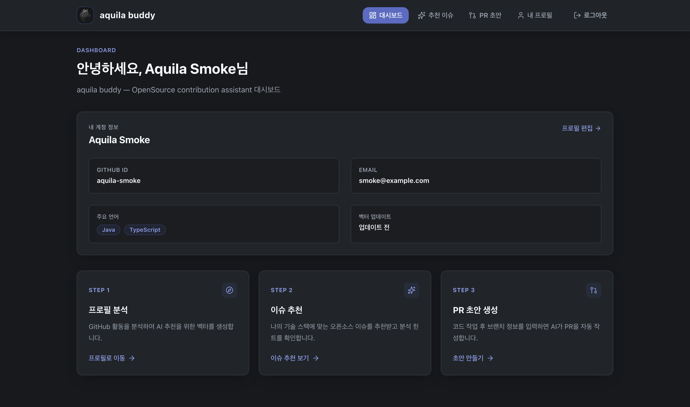
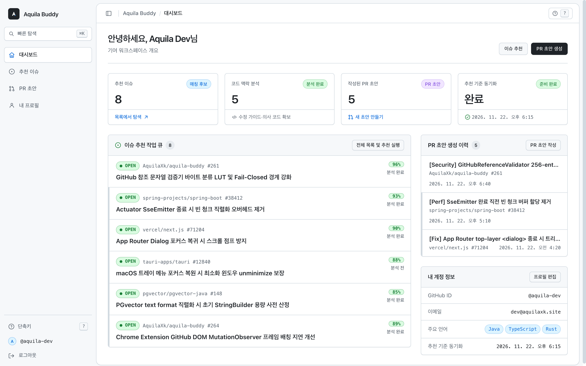
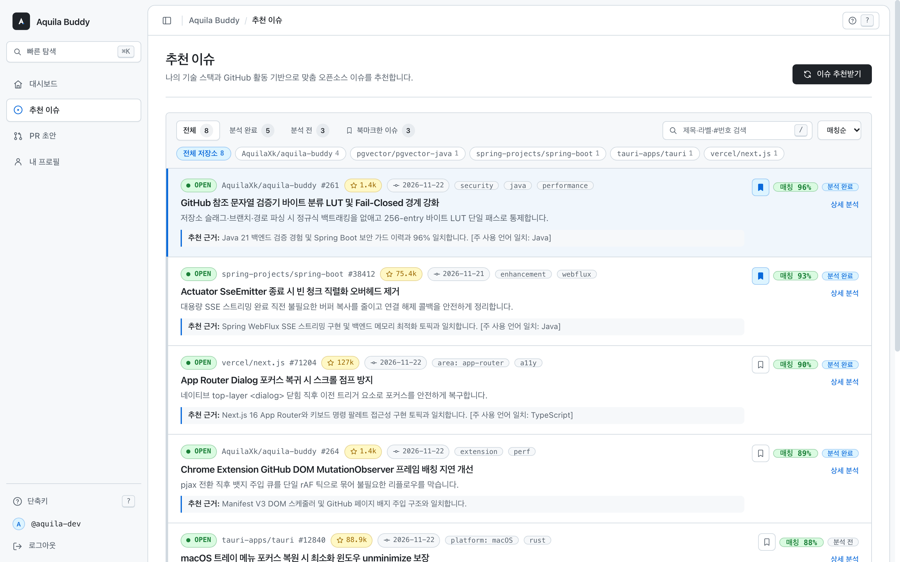
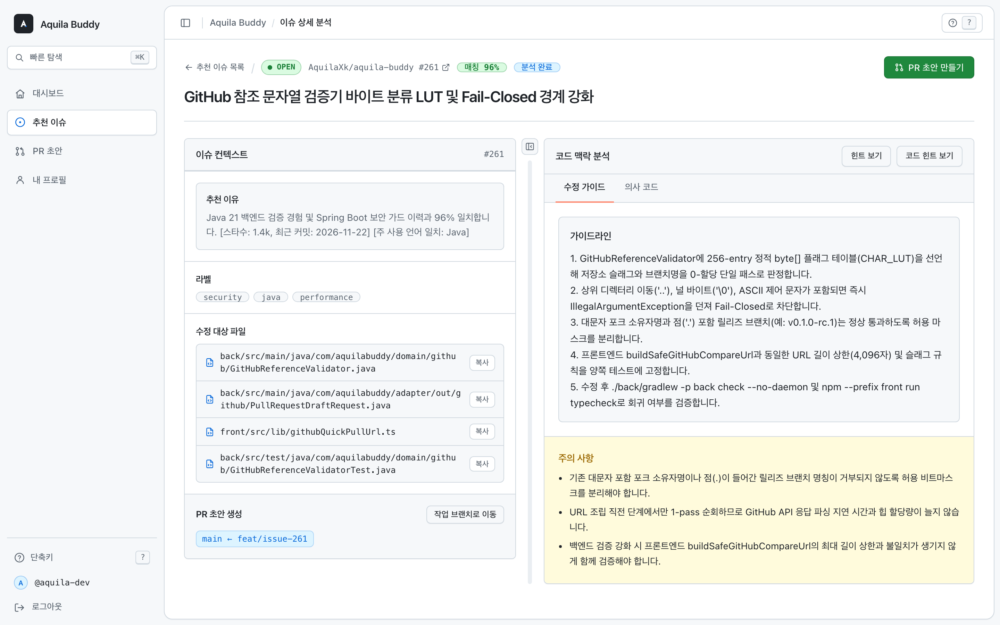
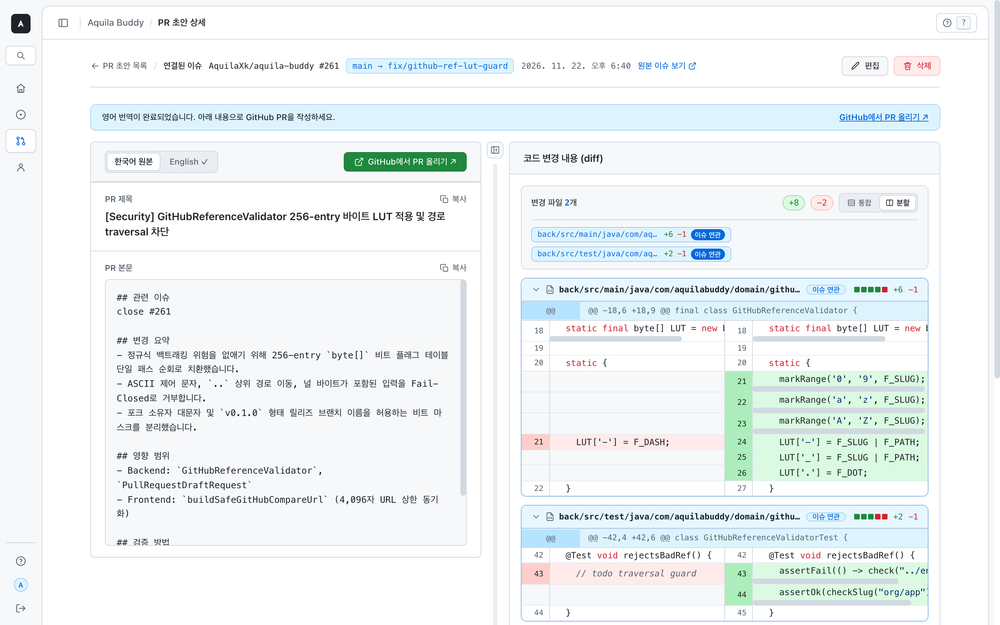
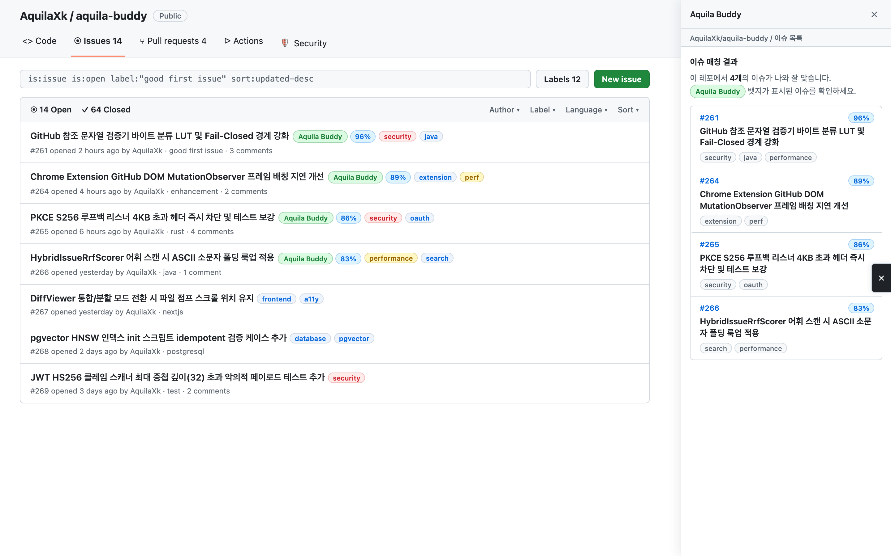

# Aquila Buddy

**GitHub 이슈 추천·코드 맥락 분석·PR 초안 작성을 한 화면에서 이어가는 오픈소스 기여 워크스페이스**

Aquila Buddy는 GitHub 활동과 기술 스택에 맞는 오픈소스 이슈를 고르고, 코드 맥락 분석부터 PR 초안 작성·사전 점검까지 한 흐름으로 처리하는 웹([buddy.aquilaxk.site](https://buddy.aquilaxk.site))·데스크톱(`macOS` · `Windows` · `Linux`)·Chrome 확장 프로그램입니다.

백엔드는 Java 21·Spring Boot 3.5와 PostgreSQL 16(`pgvector`)으로 구성했고, 데스크톱 앱은 `Tauri v2` 셸에서 OS 키체인 인증과 로컬 Git 저장소 조회를 연결합니다. 외부 연동이나 인증이 실패하면 가짜 데이터를 채우지 않고 즉시 오류를 반환합니다.



## 할 수 있는 일

* GitHub OAuth 로그인과 프로필·주요 언어·관심 토픽 동기화
* `pgvector` HNSW 코사인 거리·Okapi BM25·신선도 RRF 랭킹 추천과 `SimHash64` 준중복 이슈 제거
* 사용자별 북마크(`b`), 저장소 스타·최근 커밋 배지, `j`/`k`/`/`/`Enter` 키보드 탐색, Bitap 퍼지 검색, `⌘K` 명령 팔레트
* Git 트리·심볼 추출 기반 드래그 분할 코드 맥락 분석과 실시간 SSE 스트리밍 `수정 가이드`·`의사 코드`
* 통합·분할 `DiffViewer`, 구문 강조, 파일 점프, 비밀키 접두사를 포함한 7개 준비도 점검
* PR 초안 영문 번역 탭 대조와 GitHub 빠른 비교 PR 작성 URL 연결
* 데스크톱 앱(`macOS` 키체인 · `Windows` 자격 증명 관리자 · `Linux` Secret Service)과 RFC 8252 루프백 PKCE `S256` 인증, 로컬 Git 상태·diff 조회
* Chrome 확장 프로그램(`Manifest V3`) 이슈 배지 자동 주입, 좌측 경계 드래그 리사이즈 사이드바, GitHub PR 폼 자동 기입

## 주요 화면

<details>
<summary>핵심 기여 흐름 미리보기 (대시보드 · 이슈 추천 · 코드 맥락 분석 · PR 초안 Diff · GitHub 확장 도킹)</summary>

| 대시보드 개요 | 맞춤 이슈 추천 목록 |
| :---: | :---: |
|  |  |
| **코드 맥락·수정 가이드 스트리밍** | **PR 초안 분할 Diff 및 준비도 점검** |
|  |  |
| **GitHub 이슈 페이지 확장 도킹** | |
|  | |

</details>

## 다운로드

웹 서비스는 [buddy.aquilaxk.site](https://buddy.aquilaxk.site)에서 바로 사용할 수 있고, 데스크톱 앱과 Chrome 확장 프로그램 최신 배포본은 아래 링크 또는 [GitHub Releases](https://github.com/AquilaXk/aquila-buddy/releases)에서 받을 수 있습니다.

| 플랫폼 / 대상 | 파일 | 설명 |
| :--- | :--- | :--- |
| **macOS** | [macOS (Universal .dmg)](https://github.com/AquilaXk/aquila-buddy/releases/latest/download/AquilaBuddy-macos-universal.dmg) | Apple Silicon · Intel 통합 디스크 이미지 |
| **Windows** | [Windows (x64 .exe)](https://github.com/AquilaXk/aquila-buddy/releases/latest/download/AquilaBuddy-windows-x64-setup.exe) | Windows 10/11 x64 NSIS 설치 프로그램 |
| **Linux (x64)** | [Linux (x64 .AppImage)](https://github.com/AquilaXk/aquila-buddy/releases/latest/download/AquilaBuddy-linux-x64.AppImage) | 별도 설치 없이 실행 가능한 portable 이미지 |
| **Linux (x64)** | [Linux (x64 .deb)](https://github.com/AquilaXk/aquila-buddy/releases/latest/download/AquilaBuddy-linux-x64.deb) | Debian · Ubuntu 22.04+ 패키지 |
| **Linux (x64)** | [Linux (x64 .rpm)](https://github.com/AquilaXk/aquila-buddy/releases/latest/download/AquilaBuddy-linux-x64.rpm) | Fedora · RHEL 계열 패키지 |
| **Linux (ARM64)** | [Linux (ARM64 .deb)](https://github.com/AquilaXk/aquila-buddy/releases/latest/download/AquilaBuddy-linux-arm64.deb) | Ubuntu ARM64 패키지 |
| **Chrome 확장** | [Chrome 확장 프로그램 (.zip)](https://github.com/AquilaXk/aquila-buddy/releases/latest/download/AquilaBuddy-chrome-extension.zip) | GitHub 이슈·PR 화면 사이드바 및 배지 주입 |
| **체크섬** | [SHA256SUMS.txt](https://github.com/AquilaXk/aquila-buddy/releases/latest/download/SHA256SUMS.txt) | 전체 배포 파일 SHA-256 검증 목록 |

## 설치 유의사항

모든 데스크톱 바이너리는 공증·코드 서명 없이 배포되므로 첫 실행 시 OS 보안 경고가 뜰 수 있습니다. 내려받은 뒤에는 `SHA256SUMS.txt`로 해시를 먼저 확인하세요.

### macOS

1. `.dmg`를 열어 `Aquila Buddy.app`을 `Applications` 폴더로 옮깁니다.
2. `"Aquila Buddy"이(가) 손상되었기 때문에 열 수 없습니다.` 경고가 뜨면 아래 명령으로 격리 속성을 지운 뒤 실행합니다.
   ```bash
   xattr -cr "/Applications/Aquila Buddy.app"
   ```

### Windows

1. `AquilaBuddy-windows-x64-setup.exe`를 실행합니다.
2. SmartScreen 창이 뜨면 **추가 정보** → **실행**을 누릅니다.

### Linux

* **AppImage**: 실행 권한을 준 뒤 실행합니다(`chmod +x AquilaBuddy-linux-x64.AppImage && ./AquilaBuddy-linux-x64.AppImage`). FUSE 2가 없으면 `sudo apt install libfuse2`로 설치하세요.
* **Debian / Ubuntu (`.deb`)**: `sudo apt install ./AquilaBuddy-linux-x64.deb` 또는 ARM64용 `sudo apt install ./AquilaBuddy-linux-arm64.deb`로 설치합니다.
* **Fedora / RHEL (`.rpm`)**: `sudo dnf install ./AquilaBuddy-linux-x64.rpm`으로 설치합니다.

### Chrome 확장 프로그램

1. `AquilaBuddy-chrome-extension.zip` 체크섬을 `SHA256SUMS.txt`와 대조한 뒤 압축을 풉니다.
2. Chrome에서 `chrome://extensions`를 열고 오른쪽 위 `개발자 모드`를 켭니다.
3. `압축해제된 확장 프로그램을 로드합니다`를 눌러 압축을 푼 폴더(또는 저장소의 `extension` 폴더)를 선택합니다.
4. GitHub 이슈·PR 화면에서 `Alt+Shift+B`로 사이드바를 열거나 팝업에서 서버 환경(`local` / `prod`)과 로그인 상태를 확인합니다.

## 개발하기

```bash
docker compose up -d postgres                                        # PostgreSQL 16 + pgvector 실행
./back/gradlew -p back bootRun                                       # 백엔드 API 실행 (:8080)
NEXT_PUBLIC_API_URL=http://localhost:8080 npm --prefix front run dev # 웹 프론트엔드 실행 (:3000)
NEXT_PUBLIC_API_URL=https://buddy.aquilaxk.site npm --prefix front run build:desktop # 데스크톱 정적 export 빌드
cargo test --manifest-path front/src-tauri/Cargo.toml                # Tauri 데스크톱 Rust 단위 테스트
./back/gradlew -p back check                                         # 백엔드 단위·통합 테스트
npm --prefix front run smoke:integration                             # 프론트엔드 통합 스모크
npm --prefix extension run validate                                  # Chrome 확장 프로그램 검증
```

Java 21, Node.js 22 이상, 데스크톱 셸 빌드 시 Rust 툴체인이 필요합니다. AI provider·`pgvector`·Langfuse 운영 스모크는 [AI 운영 smoke runbook](tools/smoke/AI_RUNTIME_SMOKE.md)에, OCI 환경 배포 절차는 [OCI 배포 문서](deploy/oci/README.md)에 있습니다.

## 문제 신고

버그는 [이슈 양식](https://github.com/AquilaXk/aquila-buddy/issues/new/choose)으로 신고해 주세요. 기능 요청과 PR은 받지 않습니다. 자세한 내용은 [CONTRIBUTING.md](CONTRIBUTING.md)에, 보안 문제 신고는 [SECURITY.md](SECURITY.md)에 있습니다.

## Credits

Aquila Buddy의 인증(`RFC 7519`), 검색·지문, diff 파싱, 웹·확장 프로그램 UI 프리미티브·SVG 아이콘·시스템 폰트 토큰은 외부 UI/유틸 패키지 없이 공개 표준 명세 기반으로 직접 구현했습니다. 코어 플랫폼 런타임(`Tauri v2` 포함)과 표준 명세 구현 목록은 [THIRD_PARTY_NOTICES.md](THIRD_PARTY_NOTICES.md)에 있습니다.

License: MIT
